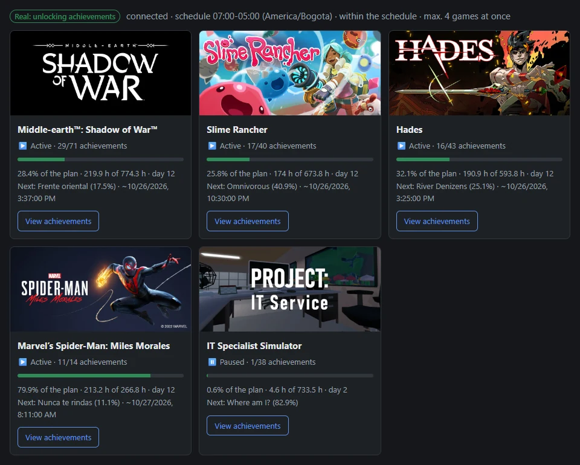
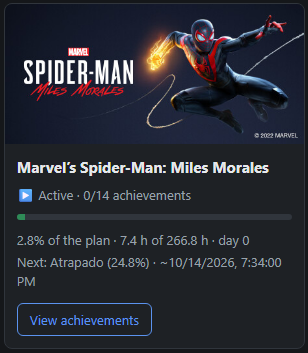
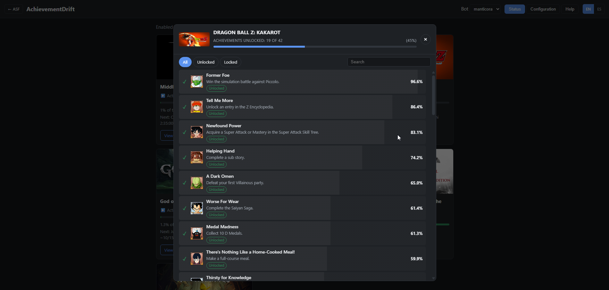
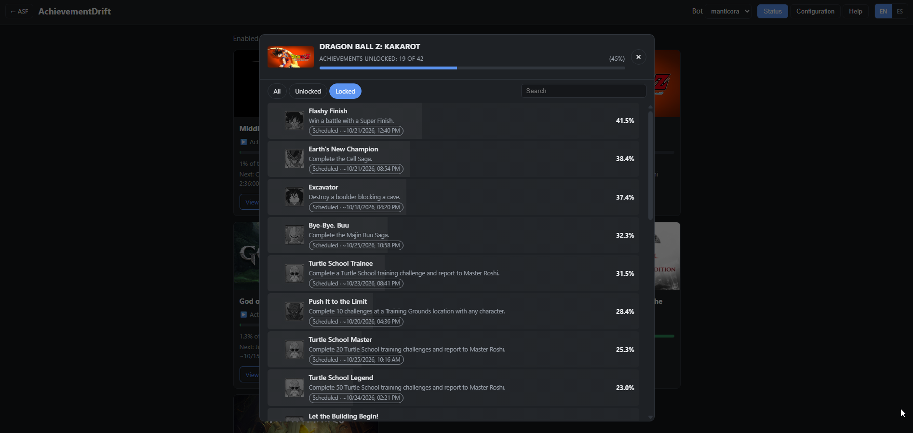
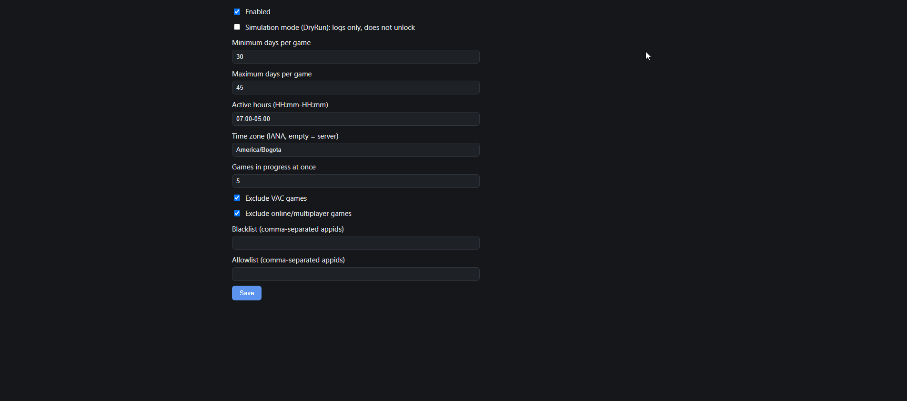
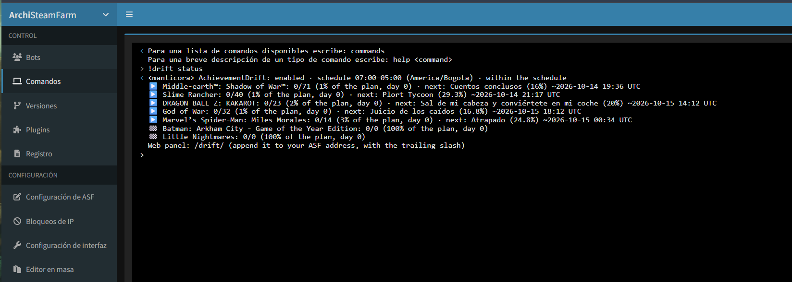

# ASF-AchievementDrift

**English** · [🇪🇸 Leer en español](README.es.md)

Plugin for [ArchiSteamFarm](https://github.com/JustArchiNET/ArchiSteamFarm) that unlocks achievements gradually and realistically while you idle hours.

## ⚠️ Important

- **Modifying achievements is against Steam's terms.** Use it at your own risk.
- Games with anti-cheat (VAC) or server-validated stats are risky. By default the plugin excludes VAC games and online/multiplayer games, but detection is not perfect (some online games do not declare their categories): use `Blacklist` when in doubt.
- `DryRun` is **on by default**: the plugin only simulates and logs what it would do. You have to turn it off yourself.

## What it does

- Achievements with a lower global unlock % take longer and tend to come **last**.
- Each game takes **at least `MinDays` calendar days** (30 by default) to complete, as long as you do not widen the active hours after its plan is created (see the FAQ).
- The unlock order and timing are **random**.
- It only progresses on games the bot **is playing right now** (`GamesPlayedWhileIdle` or card farming). If a game stops being played, its progress pauses.
- It only unlocks within configurable **human-like active hours**, in your time zone.
- At most `MaxActiveGames` games (2 by default) are in progress at once; the rest wait their turn. A started game that is still being played but doesn't get a slot (for example after lowering `MaxActiveGames`) has its plan deleted; if it gets a slot later, a new plan is made from its current Steam state.
- It automatically excludes VAC games and online/multiplayer games, plus your `Blacklist`. An `Allowlist` forces specific games in, except VAC games while `ExcludeVac` is on (VAC always wins).
- Games without store data or without the "Steam Achievements" category are excluded too; the `Allowlist` forces them in as well (and online games, but not VAC games while `ExcludeVac` is on).
- **English and Spanish**: the web panel has an EN/ES switch; commands and log messages follow ASF's language (see [Language](#language)).

## Screenshots

**Web panel (`/drift/`)**: each game in progress with its cover, plan progress and next achievement.





**View achievements**: the game's full list, like Steam, with the global % of players and the state of each achievement in the plan.





**Configuration**: edited from the panel, applied immediately.



**`!drift status`** from the ASF Commands page.



## How the algorithm works

A game's plan is created the first time an eligible game shows up as being played:

1. **Candidates:** achievements that are neither unlocked nor protected, each with its global unlock % `p` (clamped to `[0.1, 100]`; 50 if Steam does not provide it).
2. **Budget:** `T = random(MinDays, MaxDays) × window minutes per day × (pending / total)`. A calendar day cannot hold more active minutes than the window has, so a game started from scratch is not completed before `MinDays` days as long as `ActiveHours` is not widened after the plan is created (the plan is measured in active minutes: a wider window gives more minutes per day).
3. **Order:** each achievement gets the key `k = U^(1/p)` with `U` uniform in `(0,1)` and they are sorted by descending `k` (weighted sampling). Common ones tend to come first and rare ones last.
4. **Spacing:** the gap before each achievement is `(1/√p) × random(0.5, 1.5)`. Gaps are scaled to add up to `T`, with a minimum of 15 active minutes between achievements.

**Example:** active hours `10:00-01:00` (15 h = 900 minutes per day), `MinDays = 30` and `MaxDays = 45`. The budget of a new game is between 30 × 900 = **27,000** and 45 × 900 = **40,500** active minutes. A 2% achievement waits on average about 6 times longer than an 80% one (`√(80/2) ≈ 6.3`), and the 2% one comes after the 80% one in about 97% of the plans.

Every minute (a "tick") the plugin adds one active minute to the games in progress and unlocks at most **one achievement per tick and per bot**: the oldest pending one whose time has come. Even if several achievements are overdue (for example after a pause), the same game never unlocks two achievements less than 15 active minutes apart.

If Steam fails for a game (no response, a temporary error, or its plan cannot be created), that game gives its slot to another one and is retried after 30 minutes; the other games keep progressing. If the same achievement fails 5 times in a row, it is skipped. If the global percentages cannot be fetched after 3 attempts, the plan is created assuming 50% for each achievement.

## Requirements

- ASF **6.3.10.5** or compatible.
- Works with the ASF **`generic`** build and with the OS-specific builds (`win-x64`, `linux-x64`…). The OS-specific builds are published trimmed and have no time zone database: there `ActiveHours` follow the system time zone and the `TimeZone` setting is not available (the plugin logs a warning on load). If you need `TimeZone`, use the `generic` build. **The official Docker image (`justarchi/archisteamfarm`) is trimmed too**, and containers usually run in UTC, so with Docker run ASF-generic on Microsoft's .NET image (see [Docker](#docker)).
- The bot must be idling hours, usually with `GamesPlayedWhileIdle` (or farming cards).

## Installation

1. Download `AchievementDrift.zip` from the [latest release](https://github.com/owenunda/ASF-AchievementDrift/releases/latest).
2. Extract its contents into `plugins/AchievementDrift/` inside your ASF folder.
3. Restart ASF.
4. Check the log for the line `AchievementDrift ... loaded` and that the plugin shows up in the **Plugins** tab of the ASF panel.

### Docker

The official image is trimmed (no `TimeZone`, see [Requirements](#requirements)), so run the `generic` build on `mcr.microsoft.com/dotnet/aspnet` instead. Download [`ASF-generic.zip`](https://github.com/JustArchiNET/ArchiSteamFarm/releases/latest), extract it into a folder (`./asf` below, owned by UID 1000) and use a compose like this one:

```yaml
services:
  asf:
    image: mcr.microsoft.com/dotnet/aspnet:10.0
    restart: unless-stopped
    user: "1000:1000"
    working_dir: /asf
    entrypoint: ["dotnet", "/asf/ArchiSteamFarm.dll", "--no-restart"]
    environment:
      - ASF_CRYPTKEY=${ASF_CRYPTKEY}
      - ASPNETCORE_URLS=
      - HOME=/asf
    volumes:
      - ./asf:/asf
      - ./config:/asf/config
      - ./logs:/asf/logs
    ports:
      - "1242:1242"
```

- The plugin goes in `./asf/plugins/AchievementDrift/` (next to the official plugins that come with ASF-generic).
- ASF updates itself in `./asf`: after an update it exits (`--no-restart`) and Docker starts it again.
- For the IPC to listen inside the container, `config/IPC.config` must bind `http://*:1242`.
- Containers usually run in **UTC**: set `TimeZone` to your zone (the `/drift/` panel detects your browser's zone and offers to use it); otherwise the active hours are applied in UTC.

## Automatic updates

With ASF's defaults (`PluginsUpdateMode` = `Whitelist` and an empty `PluginsUpdateList`) **no plugin updates itself**. To enable it for this plugin, add `AchievementDrift` to `PluginsUpdateList` in `config/ASF.json` (keeping `Whitelist`) and restart ASF:

```json
{
  "PluginsUpdateList": ["AchievementDrift"]
}
```

With `UpdateChannel` = `Stable` (the default) ASF only takes releases marked as stable/latest; with `PreRelease` it also takes test builds. `UpdateChannel` is set in `config/ASF.json` too. In that file enum values are numeric: `PluginsUpdateMode`: `0` = `Whitelist`, `1` = `Blacklist`; `UpdateChannel`: `1` = `Stable`, `2` = `PreRelease`.

## Getting started

1. Open `https://<your-asf>/drift/` (**with the trailing slash**).
2. Enter ASF's `IPCPassword` (it is stored in your browser).
3. Accept the time zone the page detects, or set yours.
4. Leave `DryRun` on and check the log: you will see `[AchievementDrift][DryRun] Would unlock "..." ...` lines.
5. When you are happy, turn `DryRun` off. While it is on, the status shows simulated achievements as done (only so you can see the progress; nothing is unlocked on Steam). When you turn it off, every plan with simulated achievements is discarded and regenerated in real mode from the real Steam state.

## Language

- **Web panel:** the **EN / ES** buttons in the header switch the language. The first time, the browser's language is used; your choice is remembered. Achievement names in the "View achievements" window are requested from Steam in the panel's language.
- **Commands and log:** they follow ASF's language. Spanish when ASF runs with a Spanish culture, English otherwise. To get them in Spanish, set `"CurrentCulture": "es-ES"` in `config/ASF.json` (this also changes ASF's own messages).
- Achievement names stored in a plan (the "Next: …" on the cards and in `!drift status`) keep the language that was active when the plan was created.

## Configuration

Each bot has its own `config/AchievementDrift/<bot>.config.json`. It is edited from the web page (`/drift/`) or through the IPC API, and changes apply **immediately**, without restarting. If you edit the file by hand while ASF is running, the change does not apply until ASF restarts and may be overwritten by the next save from the web, the API or the commands. The configuration only lives in this file (not in ASF's bot JSON).

| Key | Default | Description |
|---|---|---|
| `Enabled` | `true` | Enables the plugin for this bot. |
| `DryRun` | `true` | Simulates without unlocking anything. Must be turned off by hand. |
| `MinDays` | `30` | Minimum days to complete a game. |
| `MaxDays` | `45` | Maximum days (upper bound of the draw). Must be ≥ `MinDays`. |
| `ActiveHours` | `"10:00-01:00"` | Window `HH:mm-HH:mm`; it can cross midnight. |
| `TimeZone` | server zone | IANA id (for example `America/Bogota`). In Docker the container is usually in UTC: set it (the web panel offers your browser's zone). Only available on the ASF `generic` build. |
| `MaxActiveGames` | `2` | Games in progress at once (1 to 10). |
| `ExcludeVac` | `true` | Excludes VAC games. |
| `ExcludeOnline` | `true` | Excludes games with online/multiplayer categories. |
| `Blacklist` | `[]` | Appids that are always excluded. |
| `Allowlist` | `[]` | Appids included even if they are online, have no store data or show no achievements (unless they are in `Blacklist`, or have VAC with `ExcludeVac` on). |

Invalid values are rejected (the API answers 400 with a message); a corrupt file is ignored with a warning in the log and the defaults are used. Changing `MinDays`/`MaxDays` does not regenerate existing plans; it only affects new ones.

## Commands

They require `Master` permission and act on the bot that receives the command.

| Command | What it does |
|---|---|
| `!drift status` | Progress per game, next achievement and ETA. Ends with the web panel path (`/drift/`). |
| `!drift on` / `!drift off` | Enables or disables the plugin for that bot (`Enabled`). |
| `!drift plan <appid>` | Shows a game's plan without unlocking anything. |
| `!drift replan <appid>` | Deletes a game's plan; it is regenerated when the game is active again. |

## IPC API

Protected by ASF's `IPCPassword` and visible in Swagger. Responses use ASF's `GenericResponse` format (PascalCase properties). Messages follow the `Accept-Language` header (`en` or `es`).

| Method and path | Description |
|---|---|
| `GET /Api/Drift/Bots` | Bot names. |
| `GET /Api/Drift/{bot}` | Status: games, unlocked/total achievements, % of the plan, next achievement. |
| `GET /Api/Drift/{bot}/Games/{appid}` | A game's achievements: live Steam state (name, description, icon, unlocked), global % and state in the plan (next, scheduled with estimated date, unlocked by Drift, protected, skipped). Cached for 1 minute. |
| `GET /Api/Drift/{bot}/Config` | The bot's configuration. |
| `POST /Api/Drift/{bot}/Config` | Saves the configuration (validated). |

```bash
curl -H "Authentication: <IPCPassword>" https://<your-asf>/Api/Drift/<bot>
```

## Files it creates

Everything is stored in `config/AchievementDrift/` (never in the plugin folder, because plugin updates replace it):

- `<bot>.config.json`: the bot's configuration.
- `<bot>.state.json`: the bot's plans and progress.
- `store-cache.json`: store data (name, VAC, categories) per appid.

To **reset a bot's progress**: stop ASF and delete its `<bot>.state.json`.

## FAQ

**Why is it not progressing?** Check that: (1) you are within `ActiveHours` in the `TimeZone` zone; (2) the game is not excluded (VAC, online or `Blacklist`); (3) the game is in `GamesPlayedWhileIdle` or being farmed; (4) there are not already `MaxActiveGames` games taking the slots; (5) `Enabled` is `true` and the bot is connected.

**Does it work with `!play`?** No. ASF does not store which games are requested with `!play`, so the plugin cannot detect them. Use `GamesPlayedWhileIdle`.

**Why was a game excluded?** The log tells you the reason with an `[AchievementDrift] Excluding ...` line. You can force it in with `Allowlist` (not for VAC games while `ExcludeVac` is on) or always exclude it with `Blacklist`.

**What about protected achievements?** They are skipped: they never enter the plan. If Steam rejects an unlock, that achievement is marked as skipped and a warning is logged. Temporary Steam errors (busy, unavailable, rate limited, no connection…) do not skip it: it is retried later.

**I changed the active hours and now it goes faster.** Plans are measured in active minutes. Widening the window speeds up the calendar (more active minutes per day); narrowing it slows it down.

**The `/drift` page takes me to the ASF panel or returns 404.** The URL must end with a slash: `https://<your-asf>/drift/`.

**Is there a button in the ASF panel to open it?** No: ASF-ui is ASF's official interface and plugins cannot add buttons to it. Bookmark `https://<your-asf>/drift/`; from the plugin page, **← ASF** takes you back.

**I see the "Your ASF build looks trimmed" error and the plugin is disabled.** Your ASF build is missing something the plugin needs: update the plugin, or use the `generic` build (with Docker, see [Docker](#docker)). The warning about the time zone database is different: the plugin works, only `TimeZone` is unavailable.

## Building from source

```bash
git clone --recursive https://github.com/owenunda/ASF-AchievementDrift.git
cd ASF-AchievementDrift
dotnet test AchievementDrift.Tests
dotnet publish AchievementDrift -c Release -o out
```

More details (in Spanish) in [docs/DEVELOPMENT.md](docs/DEVELOPMENT.md).

## License

[Apache-2.0](LICENSE.txt).
